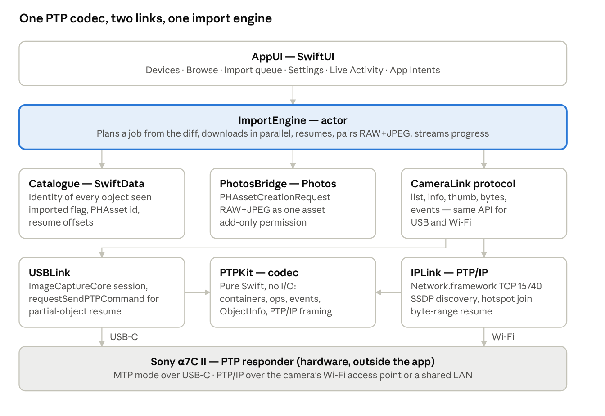
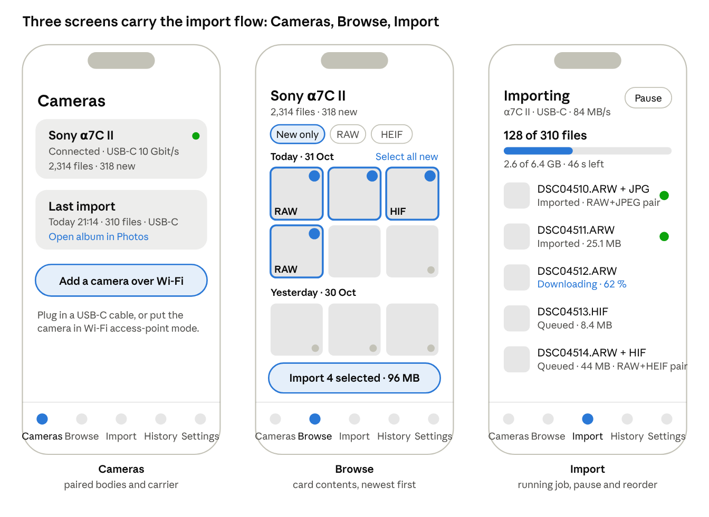
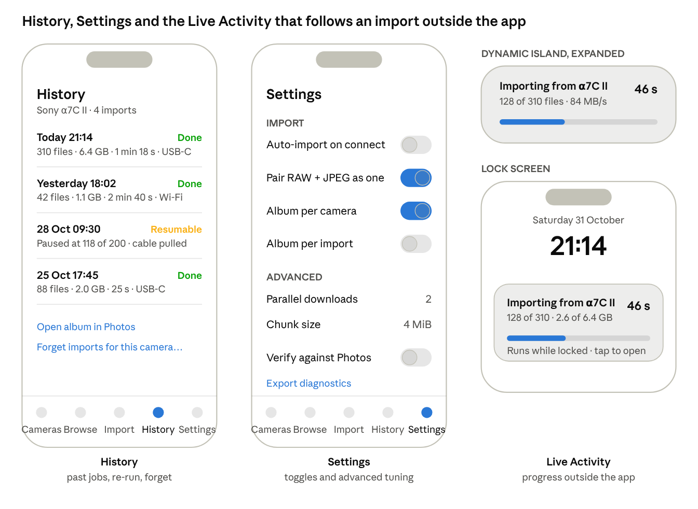
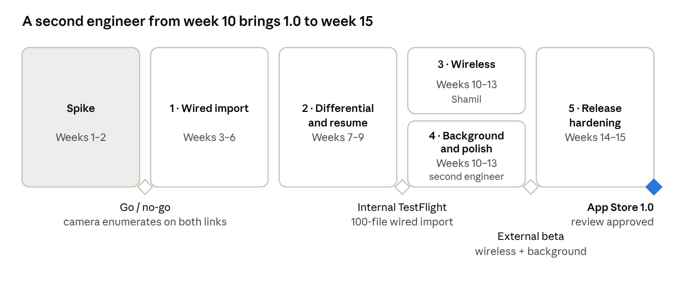

# Camera Import for iPhone — Proposal & Architecture (iOS 27)

Oct 31, 2026 · Shamil · Live copy with editable diagrams: https://claude.ai/artifact/S9gWVRBNxFB63Qe2B1GbzT

## Summary

**Shutter Bridge** (working title) is a native, iPhone-only app that imports stills (and, from 1.1, video) from a Sony α7C II to the iPhone over USB-C or Wi-Fi, with differential (only-what's-new) sync, interrupt/resume, and direct delivery into the Photos library. It reproduces the *import* half of Sony's Creators' App and deliberately nothing else: no remote shooting, no cloud, no firmware updates.

The technical bet is to speak the open standards the camera already supports — PTP (ISO 15740) over USB via Apple's `ImageCaptureCore`, and PTP/IP over Wi-Fi via our own Swift implementation on `Network.framework` — rather than reverse-engineering Sony's proprietary phone protocol. That keeps the app App Store-safe, testable without a camera (a PTP simulator), and extensible to any PTP-speaking body (other Alphas, Canon, Nikon, Fujifilm) later.

Target: iOS 27 SDK, Swift 6, SwiftUI, Xcode 27. Five development iterations take it from a two-week feasibility spike to a 1.0 on the App Store in 15 working weeks: Shamil alone through Iteration 2, then a second engineer from Iteration 3 so wireless and background work run in parallel.

|  |  |
| --- | --- |
| Platform | iPhone only (USB-C models, i.e. iPhone 15 and later, for wired import; any iPhone on iOS 27 for Wi-Fi) |
| Minimum OS | iOS 27.0 |
| First camera | Sony α7C II (ILCE-7CM2), firmware 2.00+ |
| Language / UI | Swift 6, SwiftUI, Swift Concurrency |
| Key frameworks | ImageCaptureCore, Network, Photos, SwiftData, BackgroundTasks, ActivityKit, NetworkExtension, CoreBluetooth |
| Distribution | App Store, paid one-off, no in-app purchases or subscription (TestFlight for betas) |
| App Store name | Shutter Bridge (working title, pending a trademark and App Store search); no Sony marks in the name or icon; the subtitle carries compatibility, e.g. “Photo import for Sony Alpha cameras” |

## What we are matching: Creators' App import behaviour

The behaviours below are taken from Sony's [Creators' App catalogue](https://creatorscloud.sony.net/catalog/en-ie/creatorsapp/index.html) and [help guide](https://helpguide.sony.net/di-app/ca/v1/en/print.pdf). Each row is a requirement for 1.0 unless marked *later*.

| Creators' App behaviour | How it works there | Our 1.0 target |
| --- | --- | --- |
| Wired transfer over USB-C | Camera to phone with a USB-C cable, no adapter; USB 3.2 speeds when camera, phone and cable all support it | Yes — `ImageCaptureCore` PTP session; iPhone 15 Pro/16/17-class ports run USB 3 (10 Gbit/s), base iPhone 15/16 run USB 2 |
| Wireless transfer over Wi-Fi | Camera and phone paired; Bluetooth brings up the Wi-Fi link automatically | Yes for Wi-Fi (PTP/IP on the camera's access point or a shared LAN); Bluetooth proximity detection with a dismissible import reminder is in 1.0; Bluetooth wake of the camera's Wi-Fi is *later* |
| Transfer while shooting | New shots stream to the phone as they are taken | *Later* — depends on PTP `ObjectAdded` events over the live session (spike item) |
| Interrupt, resume, differential transfer | Transfer resumes after interruption; only files not yet on the phone are sent; more files can be queued mid-transfer | Yes — catalogue of imported object identities; `GetPartialObject` for byte-range resume; mutable queue |
| Preview video before transfer | Clip preview on the phone before choosing it | *Later: 1.0 is stills only; video files are hidden by a default filter and video import is a 1.1 feature* |
| Transfer continues when the screen sleeps or you switch apps | Background continuation | Yes via `BGContinuedProcessingTask` (iOS 26+) with system progress UI, plus a Live Activity |
| JPEG, HEIF, RAW (ARW) and video (XAVC S / HS MP4) | All formats supported on recent bodies | Stills in 1.0 (JPEG, HEIF, ARW), RAW+JPEG/HEIF pairs saved as one Photos asset; video later |
| Save to the phone's photo library | Direct to Photos | Yes — `PHAssetCreationRequest`, add-only permission |
| Auto-transfer on connect | One-tap or automatic once paired | Yes (setting, off by default) |
| Location linking, remote shooting, cloud upload, firmware update | Other Creators' App features | Out of scope |

Two differences from Sony's app are intentional. First, Creators' App only shows cameras Sony lists; we accept any PTP camera that enumerates, with α7C II-specific handling where it matters. Second, Sony's phone-side protocol is proprietary; we use the camera's standard MTP/PTP mode (`USB Connection Mode → Still Img Transfer (MTP)`, which is also what the built-in Photos app uses) and its PTP/IP service over Wi-Fi.

## Goals, non-goals and constraints

**Goals for 1.0**

1. Plug in or connect an α7C II and see its card contents within 5 seconds, newest first, with thumbnails.
2. Import selected or all-new files to Photos at close to link speed: ≥ 30 MB/s wired on the USB 2 bench iPhone (≥ 80 MB/s expected on USB 3 Pro models, unverified), ≥ 8 MB/s on the camera's 5 GHz access point.
3. Never import the same file twice, never lose a half-transferred file, and resume where a transfer stopped.
4. Keep transferring when the phone locks or the user switches apps, with progress visible in the Dynamic Island.
5. Zero data leaves the phone: no accounts, no analytics beyond opt-in MetricKit crash reports.
6. When the camera comes within Bluetooth range with photos not yet imported, the phone shows a dismissible reminder within about a minute (respecting quiet hours) and import is one tap away, without the app being open.

**Non-goals** (explicitly not in any planned iteration): remote shooting and live view, firmware updates, FTP or cloud upload, RAW editing, iPad or Mac builds, Android. Video import is not in 1.0 (stills only, as Shamil shoots); it is the second post-1.0 item.

**Constraints**

- iPhone only, iOS 27.0 minimum. Wired import needs a USB-C iPhone (15 or later); the app runs on older Lightning iPhones that reach iOS 27 but hides the wired path.
- No official Sony SDK on iOS. Sony's Camera Remote SDK targets Windows, macOS and Linux only, and its mobile protocol is undocumented. We rely on ISO 15740 PTP, which Sony implements on USB and over IP.
- No raw USB access for third-party iPhone apps. `ImageCaptureCore` is the only sanctioned route to a USB camera, so the wired path is bounded by what that framework exposes (including `requestSendPTPCommand` for vendor and partial-object operations).
- App Store review: multicast networking, hotspot configuration and local-network access each need entitlements or usage strings and a justification.
- Shamil builds alone through Iteration 2; a second engineer joins at week 10 and takes Iteration 4 (background and polish) while Shamil takes Iteration 3 (wireless).
- The bench iPhone is a base model with a USB 2 port (about 35 MB/s bus ceiling). USB 3 throughput targets stay unverified until a Pro model can be borrowed for a test run.

**Assumption to confirm in the spike:** the α7C II exposes the memory card's object store over PTP/IP when connected to a phone over Wi-Fi, not only images captured during a tethered session. If it does not, wireless import in 1.0 falls back to the camera's *Send to Smartphone* flow (camera-side selection) and full browsing stays wired-only.

## Transports: how the camera talks and what iOS allows

The camera speaks one protocol, PTP, over three carriers. iOS gives us a sanctioned path for two of them today and a partial one for the third.

| Carrier | Camera side (α7C II) | iPhone side | iOS framework | Status |
| --- | --- | --- | --- | --- |
| USB-C (PTP over USB) | `Setup → USB → USB Connection Mode = Still Img Transfer (MTP)`; USB 3.2 Gen 2 port | USB-C port; USB 3 on Pro-class, USB 2 on base models | `ImageCaptureCore` (`ICDeviceBrowser`, `ICCameraDevice`, `ICCameraFile`, `requestSendPTPCommand`) | 1.0 |
| Wi-Fi (PTP/IP, TCP 15740) | Camera as access point (`Network → Wi-Fi → Access Point`) or joined to a LAN; Sony advertises the PTP/IP service over SSDP (UDP 1900) | Join the camera's SSID with `NEHotspotConfiguration`, or share the LAN; discover with SSDP or a typed IP | `Network.framework` (`NWConnection`, `NWListener` for multicast), `NetworkExtension` | 1.0 |
| Bluetooth LE (wake + pairing) | Sony's BLE service powers the camera on and hands over Wi-Fi credentials | Core Bluetooth central | `CoreBluetooth` | 1.0 for proximity detection (advertisement match only, no GATT traffic); camera wake and Wi-Fi credential hand-off later — Sony's GATT profile is undocumented and only the remote-shutter part is well understood by the community |

**PTP in one paragraph.** A session is opened with `OpenSession`; `GetStorageIDs` and `GetObjectHandles` list the card; `GetObjectInfo` returns filename, capture date, size and format per handle; `GetThumb` returns an embedded thumbnail; `GetObject` or `GetPartialObject(handle, offset, length)` fetches bytes; the camera pushes `ObjectAdded` events when a new shot lands. Everything the import feature needs is in that vocabulary, which is why one `PTPKit` codec serves both carriers.

**Why we do not use Sony's own protocols.** Creators' App uses a proprietary transport (and, for older bodies, the retired Camera Remote API over HTTP). Reverse-engineering it would make the app fragile against firmware updates and is a poor fit for App Store review. PTP is standardised, stable since 2005, and what Sony itself relies on for PC Remote and MTP import.

**What iOS does not allow.** No raw USB endpoints for iPhone apps (DriverKit is Mac and iPad only), no Wi-Fi scanning, no silent joining of networks (the user confirms every `NEHotspotConfiguration` join), and no unlimited background execution. Each is designed around below rather than fought.

## Languages, frameworks and tooling

Swift 6 with strict concurrency throughout, SwiftUI for every screen, and Apple frameworks only — no third-party dependencies in the shipping app. The one thing we write from scratch is the PTP/PTP-IP codec, because nothing on iOS provides it.

| Concern | Choice | Why, and what was rejected |
| --- | --- | --- |
| Language | Swift 6 (Xcode 27 toolchain), strict concurrency on | Actors give the import engine a safe single-writer model; `Sendable` checking catches cross-thread bugs in the transport layer at compile time. Objective-C only where `ImageCaptureCore` delegates force it. |
| UI | SwiftUI, `@Observable` view models, Liquid Glass system styling | Native look on iOS 27, less code than UIKit, previews for agent-driven iteration in Xcode 27. UIKit only for `PHPickerViewController`-style hosted controllers if needed. |
| Concurrency | Swift Concurrency: actors, `AsyncStream` for progress, `TaskGroup` for parallel downloads | No GCD or Combine in new code. |
| USB camera access | `ImageCaptureCore` | Only sanctioned API. `ICCameraDevice.requestSendPTPCommand` gives us `GetPartialObject` and Sony vendor ops for resume. |
| Wi-Fi transport | `Network.framework` (`NWConnection` TCP, `NWConnectionGroup`/UDP multicast for SSDP) | Modern, async-friendly, honours Local Network privacy. `NEHotspotConfiguration` (NetworkExtension) to join the camera's SSID. Rejected: CFNetwork/BSD sockets (no privacy integration), `NetService` (deprecated). |
| Protocol codec | `PTPKit` — own Swift package, pure Foundation, no I/O | Pure functions over `Data` so it is unit-testable and fuzzable without hardware; shared by USB and IP paths. |
| Local catalogue | SwiftData (`ModelActor` for background writes) | Schema migrations built in; CloudKit sync possible later. Rejected: Core Data directly (more boilerplate), GRDB/SQLite (third-party). |
| Photo library | `Photos` + `PhotosUI` (`PHAssetCreationRequest`, `PHAssetResourceType.alternatePhoto` for RAW+JPEG pairs) | Add-only access level keeps the permission prompt minimal. |
| Thumbnails and RAW | `ImageIO` (`CGImageSource` with embedded-thumbnail options), `CoreImage` `CIRAWFilter` for ARW previews when the camera thumbnail is too small | Apple's RAW decoder supports recent Sony ARW; verify α7C II on the iOS 27 support list in the spike. |
| Background work | `BackgroundTasks` — `BGContinuedProcessingTask` for user-started imports; `ActivityKit` Live Activity for progress | Introduced in iOS 26; the first API that lets a foreground-started transfer legitimately continue with system progress UI. |
| System integration | `AppIntents` ("Import new photos from camera"), `WidgetKit` lock-screen progress, `OSLog` + `MetricKit` | Shortcuts and Siri for free; structured logs for field debugging. |
| Testing | Swift Testing for units, XCTest UI tests, a `PTPSimulator` package that serves a fake camera over TCP | Lets CI exercise the full import pipeline with no hardware. |
| CI/CD | Xcode Cloud (2× faster in the 27 cycle per Apple), TestFlight, fastlane only for screenshots | Keeps signing and distribution inside Apple's tooling. |
| Project layout | Swift Package Manager workspace: `PTPKit`, `CameraTransport`, `ImportEngine`, `Catalogue`, `PhotosBridge`, `AppUI`, `PTPSimulator` | Enforces the layering in the architecture section; each package builds and tests alone. |
| Proximity reminder | CoreBluetooth central with the bluetooth-central background mode and state restoration; UserNotifications for the alert | The only sanctioned way to be woken when a known device appears; we match the camera's advertised service UUID and never read Sony's characteristics in 1.0 |

Tooling notes for Xcode 27: coding-intelligence agents can run the simulator through Device Hub, but cameras over USB never reach the simulator — all transport work is tested on a physical iPhone, and the `PTPSimulator` is what the simulator talks to over loopback.

## System architecture

The app is six Swift packages in strict layers: UI talks only to the import engine; the engine talks to a catalogue, a Photos bridge and a `CameraLink` protocol; two links implement that protocol, one per carrier, and share a single PTP codec.

The import engine is the only component that knows about jobs, ordering and resume; the links are dumb pipes that answer `list / info / thumb / bytes / events` and nothing else. Swapping a Sony body for a Canon one changes vendor extensions inside `PTPKit`, not the engine.

Not drawn: `ProximityMonitor`, a Core Bluetooth central inside `CameraTransport`. It never carries image data; it wakes the app when the paired camera advertises nearby and hands a "camera nearby" event to the engine, which decides whether there is anything new to remind about.

**Concurrency model.** `ImportEngine` is an actor and the single writer of job state. Each `CameraLink` is also an actor that owns its connection; PTP is strictly request-response per session, so an actor's serialised mailbox is exactly the right shape (one outstanding command at a time, events delivered on a side channel). Downloads of different files run in a `TaskGroup` with a concurrency limit of 2 on USB (the bus is the bottleneck) and 3 on Wi-Fi. Progress reaches the UI as an `AsyncStream<ImportProgress>` consumed by an `@Observable` view model on the main actor; SwiftData writes go through a `ModelActor` so the main thread never blocks on the catalogue.

**Data flow for one import.** `AppUI` asks the engine to import a selection → the engine diffs the selection against the `Catalogue` → for each new object it asks the link for bytes into a temp file (`FileManager.temporaryDirectory`, resumable by offset) → on completion `PhotosBridge` creates the asset (RAW+JPEG paired by base filename) → the catalogue records the `PHAsset.localIdentifier` → the temp file is deleted. A crash at any step leaves either a resumable temp file or a catalogue row that the next run reconciles against Photos.

**Dependency rules** (enforced by SPM: a package imports only the ones below it): `AppUI → ImportEngine → {Catalogue, PhotosBridge, CameraTransport} → PTPKit`. `PTPSimulator` depends on `PTPKit` only and is a test dependency.

## Import engine design

The engine runs five stages; every stage is idempotent so a crash, cable pull or Wi-Fi drop at any point is recovered by simply running the job again.

1. **Discover.** `USBLink` starts an `ICDeviceBrowser` with the camera mask and surfaces each `ICCameraDevice` as a `CameraDescriptor` (name, serial, carrier). `IPLink` listens for SSDP `NOTIFY`/`M-SEARCH` replies carrying Sony's `urn:schemas-sony-com:service:DigitalImaging` header and also accepts a manually typed IP for networks that block multicast. Descriptors are merged by serial so a camera reachable on both carriers shows once, with the faster carrier preferred.
2. **Open a session.** USB: `requestOpenSession()` on the device, then `requestSendPTPCommand` for `GetDeviceInfo` to learn supported operations (we check for `GetPartialObject` 0x101B and Sony's vendor extension ID 0x0011). Wi-Fi: PTP/IP `Init_Command_Request` with a stable per-install GUID and friendly name (the camera remembers paired initiators), `Init_Event_Request` on a second TCP connection, then `OpenSession`.
3. **Enumerate and diff.** Walk `GetStorageIDs → GetObjectHandles` per storage, fetch `GetObjectInfo` for each handle (batched 32 at a time, newest first so the top of the list fills in under a second). Each object's identity is `(camera serial, filename, capture date, size)` — handles are not stable across sessions, filenames alone collide after the camera's counter wraps. The catalogue answers *new / imported / partially downloaded* for each identity; only *new* and *partial* enter the queue.
4. **Download.** Per object: allocate a temp file, read the catalogue's resume offset, then loop `GetPartialObject(handle, offset, 4 MiB)` until size is reached, appending and advancing the offset in the catalogue every 16 MiB. USB-C on `ImageCaptureCore` also supports plain `requestDownloadFile` as a fast path when the object is new and the camera lacks partial reads. Two or three objects are in flight at once; a per-carrier token bucket keeps PTP commands serialised on each link. Throughput and ETA are published on the progress stream every 250 ms.
5. **Commit.** When bytes equal the advertised size, hand the temp file to `PhotosBridge`. A `.ARW` and `.JPG`/`.HEIF` with the same stem are committed together as one asset (`.photo` + `.alternatePhoto`), with the camera's capture date and, if present, GPS from EXIF applied to the `PHAssetCreationRequest`. The catalogue row flips to *imported* with the `localIdentifier`; the temp file is removed.

**Differential rules.** The default selection is *everything not yet imported*. The user can narrow it to a date range or hand-pick. A file deleted from Photos stays *imported* in the catalogue unless the user chooses "Forget imports" for the camera, matching Creators' App.

**Resume rules.** On reconnect the engine resumes any *partial* rows first, verifying the object still exists and its size matches before continuing from the saved offset; a mismatch restarts that file from zero. Queue edits during a transfer are allowed: adding files appends to the plan, removing an in-flight file cancels its task and deletes the temp file.

**Live capture (later).** With a session open, the camera emits `ObjectAdded` events; the engine treats each as a one-item diff, so transfer-while-shooting is a configuration flag rather than a new pipeline.

**Error taxonomy.** Every link error maps to one of four engine outcomes: *retry now* (transient PTP busy), *retry on reconnect* (link lost), *skip this file* (unsupported format, corrupt object), *stop the job* (storage full on the phone, Photos permission revoked). The UI shows the outcome, not the PTP response code; the code goes to `OSLog`.

## Data model and storage

Three SwiftData models hold everything the app needs to remember; media itself never lives in the app container longer than a transfer.

| Model | Key fields | Purpose |
| --- | --- | --- |
| `Camera` | `serial` (unique), `model`, `friendlyName`, `lastSeen`, `preferredCarrier`, `autoImport: Bool`, `wifiSSID?`, `lastIP?`, `ptpipGUID` | One row per paired body; the PTP/IP initiator GUID is per camera so re-pairing one does not disturb another |
| `CameraObject` | `camera`, `filename`, `captureDate`, `size`, `format` (JPEG/HEIF/ARW/MP4/other), `state` (new / partial / imported / skipped), `resumeOffset`, `tempURL?`, `assetLocalID?`, `pairStem` | The diff ledger; `(camera, filename, captureDate, size)` is the uniqueness constraint |
| `ImportJob` | `camera`, `startedAt`, `finishedAt?`, `selection` (all-new / range / explicit), `bytesTotal`, `bytesDone`, `outcome` | History screen and the source of the Live Activity's numbers |

**Photos library.** Assets are created with `PHAssetCreationRequest`, resources from file URLs (no copy into memory). RAW+JPEG becomes one asset with the JPEG/HEIF as `.photo` and the ARW as `.alternatePhoto`, which is how the built-in import treats pairs and what Lightroom and Darkroom expect. Video is wired through the same path as a `.video` resource (XAVC HS plays natively) but stays hidden behind the default filter until 1.1. Each import also adds the assets to a per-camera album ("α7C II") and, if the user enables it, a per-job album by date. The app requests `.addOnly` access so the permission sheet is the small one; `.readWrite` is requested only if the user turns on "Verify imports against Photos" (used to detect assets they deleted).

**File formats to handle explicitly** (α7C II): `.ARW` (14-bit RAW, lossless-compressed or uncompressed), `.JPG`, `.HIF` (HEIF, including HLG stills), `.MP4` (XAVC S H.264 and XAVC HS H.265, up to 4K 60p; hidden until 1.1) and, from 1.1, the `.XML` sidecars the camera writes beside video clips. Thumbnails come from PTP `GetThumb` (160×120 for ARW; the embedded JPEG preview is fetched via `GetPartialObject` on the first 512 KiB when a larger preview is needed).

**Local files.** Temp downloads live under `Caches/Imports/<camera serial>/<filename>.part` so the system can purge them under pressure (the catalogue's `resumeOffset` is then reset on next open). Nothing else is written to disk: thumbnails are cached in memory with `NSCache` keyed by object identity. No iCloud sync of the catalogue in 1.0; the schema is CloudKit-compatible for a later opt-in.

## UX and screens

Five screens, one tab bar, no onboarding beyond the two permission sheets. The design language is the system's (Liquid Glass on iOS 27), so the app looks like Photos rather than like a Sony product.

| Screen | What it shows | Key interactions |
| --- | --- | --- |
| Cameras | Paired and currently reachable cameras, carrier badge (USB-C / Wi-Fi), battery and card free space if the camera reports them; empty state explains the cable or the camera's Wi-Fi menu path | Tap to open; "Add over Wi-Fi" runs the join flow; swipe to forget |
| Browse | Grid of the card's contents newest first, section headers per day, badges for RAW, HEIF and *already imported*; filters: new only, date range, type (video hidden by default in 1.0) | Multi-select with drag, "Select all new", tap for a full-screen preview with EXIF |
| Import | The running job: per-file rows with progress, throughput, ETA, pause/resume, cancel; the queue can be reordered or added to while running | Pull to pause; files added from Browse land at the end |
| History | Past jobs with counts, bytes, duration, outcome; tap opens the album in Photos | Re-run a failed job; "Forget imports" per camera |
| Settings | Auto-import on connect, RAW+JPEG pairing, album naming, verify against Photos, concurrency and chunk size (advanced), diagnostics export | Toggles; diagnostics export writes an `OSLog` archive the user can share |

**Mockups.** Wireframe fidelity: layout, hierarchy and copy are as intended; colour, iconography and Liquid Glass materials come from the system at build time.

In Browse, an accent ring and corner dot mark a selected file, a grey corner dot marks one already imported; the sticky action bar always shows the count and size of the selection.

History keeps a *Resumable* row for any job that stopped early; tapping it re-opens Import with the remaining files already queued. The Live Activity carries the same four numbers everywhere — files done, files total, bytes and ETA — so the Dynamic Island, Lock Screen and Import screen never disagree.

**Progress outside the app.** A Live Activity shows files done / total, MB/s and ETA in the Dynamic Island and on the Lock Screen for the whole job; tapping it returns to the Import screen. When the system's `BGContinuedProcessingTask` UI is visible it carries the same title and progress.

**Wi-Fi join flow.** The user sets the camera to its Wi-Fi access-point mode; the app shows the camera's screen instruction, scans the QR code the camera displays (SSID and password are encoded in Sony's `W01:` QR format) with `DataScannerViewController`, calls `NEHotspotConfigurationManager` to join, and starts SSDP discovery. A typed IP is the escape hatch. On a shared LAN (for example a home UniFi network with the camera registered to the access point) the join step is skipped. Both setups are first-class: discovery, pairing and the hardware test plan cover each equally.

**Accessibility and localisation.** Full VoiceOver labels on the grid (filename, date, type, imported state), Dynamic Type through the largest accessibility size, Reduce Motion respected in progress animations. English only at launch; strings live in a String Catalog from day one so Japanese and German can follow in a point release without code changes.

**App Intents.** "Import new photos from α7C II" and "How many new photos are on the camera?" are exposed to Shortcuts and Siri, so a user can automate import on a Focus change or a Personal Automation when the phone connects to the camera's SSID.

## Background execution, power and performance budget

A transfer the user started keeps running when the phone locks or they switch apps, because the job is wrapped in a `BGContinuedProcessingTask` (iOS 26+); when the system ends that task early, the engine checkpoints and resumes on return.

**Background strategy, in order of preference**

1. `BGContinuedProcessingTask` submitted when the user taps Import. It carries a title and progress the system shows; it is the designed API for exactly this case and does not need a background-mode entitlement. The task's expiration handler flushes resume offsets and pauses the queue cleanly.
2. If the system refuses or ends the task (thermal pressure, Low Power Mode), fall back to `beginBackgroundTask` for the current file only (\~30 s), then suspend; the Live Activity says "Paused — open to continue".
3. On return to foreground the engine resumes automatically; the USB session survives suspension in practice, the PTP/IP session is re-established (the camera keeps the AP up for several minutes).

**Performance budget** (measured in the spike; targets for 1.0)

| Metric | Target | Notes |
| --- | --- | --- |
| Camera visible after connect | ≤ 2 s wired, ≤ 5 s Wi-Fi | Includes `GetDeviceInfo` and first storage listing |
| First screen of thumbnails | ≤ 1 s after listing | Newest 60 objects first; rest lazily |
| Wired throughput, USB 3 iPhone | ≥ 80 MB/s | Expected, not measurable on the bench (no USB 3 iPhone). A 33 MP ARW is \~35 MB lossless-compressed; 100 RAW+JPEG pairs in about 1 min |
| Wired throughput, USB 2 iPhone | ≥ 30 MB/s | The bench iPhone; bus limit \~35 MB/s; 100 pairs in about 2.5 min |
| Wi-Fi throughput, camera AP, 5 GHz | ≥ 8 MB/s | Camera-side limit; 100 pairs in \~6 min |
| Memory high-water mark during import | ≤ 150 MB | 4 MiB chunks, streamed to disk, thumbnails in `NSCache` |
| Energy | "Low" in Xcode Energy gauge during wired import | No polling; events drive the UI |

**Techniques.** Chunked `GetPartialObject` with two in-flight files keeps the bus busy without large buffers. Thumbnail decoding uses `CGImageSourceCreateThumbnailAtIndex` with `kCGImageSourceThumbnailMaxPixelSize` so ARW previews never decode the full RAW. The Photos commit runs on the catalogue's `ModelActor` queue, off the download path. The grid uses `LazyVGrid` with stable identities so a job in progress does not re-layout the whole screen on every progress tick (progress is throttled to 4 Hz).

## Proximity reminder over Bluetooth LE

When the camera comes within Bluetooth range with photos the phone has not imported, the phone shows a reminder within about a minute and import is one tap away. A fully silent multi-gigabyte sync is not something iOS permits from the background, so 1.0 stops at the reminder and 1.1 adds a bounded background check.

**How it works in 1.0**

1. **Link.** On the first USB or Wi-Fi connection the Cameras screen offers "Link Bluetooth". The app scans for the Sony camera service UUID (recorded on spike day 6), lets the user pick the matching peripheral, and stores its identifier beside the camera serial.
2. **Watch.** The app runs a `CBCentralManager` with the `bluetooth-central` background mode and a restore identifier, and calls `scanForPeripherals(withServices:)` for that one UUID. iOS keeps the scan alive while the app is suspended and relaunches it after a reboot; Apple requires a specific service UUID for background scans, which is why the link step matters.
3. **Wake and decide.** On discovery iOS wakes the app for a few seconds. The app checks quiet hours and the per-camera mute, debounces to one reminder per camera per 30 minutes, compares the camera's last-seen card state with the catalogue, and if there is something new posts an alert-style local notification: "α7C II is nearby · 318 photos not yet imported" with the actions *Import now*, *Not now* and *Snooze today*. Swiping it away is the same as *Not now*. The Cameras screen shows a *nearby* badge the next time it opens.
4. **Import.** Tapping *Import now* brings the app to the foreground, which is the only state from which `BGContinuedProcessingTask` can carry a long import to completion. From there the flow is the ordinary one.

**1.1: differential check on wake.** If the camera's Wi-Fi is already up on the home LAN (registered access point, camera awake), the wake handler opens a PTP/IP session and runs `GetObjectHandles` plus `GetObjectInfo` for new handles only, then updates the reminder with the real count and a few previews — all inside the 10–30 s the system allows. Bringing the camera's Wi-Fi up over Bluetooth is Sony's proprietary handshake and remains the 1.1 reverse-engineering item; joining the camera's own access point from the background is not permitted at all.

**Constraints.** Background scanning cannot use a wildcard, coalesces repeated advertisements into one callback, and stops when Bluetooth is off or Low Power Mode is on. If the α7C II does not advertise while powered off (Sony's *Remote Power ON/OFF* setting is meant to keep the radio up; the spike confirms), detection works only while the camera is on. Because 1.0 reads no Sony characteristic, a firmware change can break detection only by changing the advertised UUID.

**Settings.** Reminders on or off (default on after linking), quiet hours (default 22:00–08:00), snooze length, mute per camera, and "only when on home Wi-Fi".

## Privacy, permissions, entitlements and App Store

The app asks for two permissions at first use and two more only when the user turns on Wi-Fi import; it needs three entitlements, one of which (multicast) requires a request to Apple.

| Need | Mechanism | When asked | Justification text (draft) |
| --- | --- | --- | --- |
| Talk to a USB camera | `NSCameraUsageDescription` (ImageCaptureCore reuses the camera privacy string on iOS), then `ICDeviceBrowser.requestContentsAuthorization()` and `requestControlAuthorization()` before `start()` | First launch with a cable | "Reads photos and videos from a camera connected by USB-C." Note: developer-forum reports say the iOS 26.1 beta returned notDetermined from these requests; re-test on iOS 27 on day 1 |
| Add to Photos | `NSPhotoLibraryAddUsageDescription`, `.addOnly` | First import | "Saves imported photos and videos to your library." |
| Find the camera on Wi-Fi | `NSLocalNetworkUsageDescription` + `NSBonjourServices` (`_ptp._tcp`) | First Wi-Fi discovery | "Finds your camera on the local network." |
| Join the camera's network | `com.apple.developer.networking.HotspotConfiguration` entitlement | Each join (system sheet) | — |
| SSDP multicast | `com.apple.developer.networking.multicast` entitlement (granted on request via Apple's form) | Build-time | Discovery of PTP/IP cameras that only announce over SSDP |
| Scan the camera's QR code | `NSCameraUsageDescription` | Only when the user taps "Scan code" | "Scans the pairing code shown on your camera's screen." |
| Background continuation | `BGTaskSchedulerPermittedIdentifiers` with the continued-processing identifier | Build-time | — |
| Notice the camera nearby and remind | NSBluetoothAlwaysUsageDescription; UIBackgroundModes bluetooth-central; UNUserNotificationCenter authorisation for alerts | When the user taps Link Bluetooth | "Notices when your camera is nearby so it can remind you about new photos." |

**Privacy posture.** No account, no server, no third-party SDK, no advertising identifier. The App Privacy label is "Data Not Collected". Diagnostics are an opt-in `OSLog` export the user shares themselves; crash reports arrive through Apple's own opt-in channel. Camera serials stay on device.

**App Store review notes.** Reviewers rarely have a Sony body; the submission includes a demo video and a review build that bundles `PTPSimulator` behind a hidden gesture so every screen can be exercised on a plain iPhone. The multicast entitlement must be approved before the first TestFlight external build; apply in the spike week. Trademark: "Sony", "Alpha" and "α7C II" appear only descriptively ("works with"), never in the app name or icon.

**Security.** PTP/IP has no authentication; the camera accepts any initiator it has paired with once. The app therefore never auto-joins unknown SSIDs, pins the camera by serial after first pairing, and refuses sessions whose `GetDeviceInfo` serial changes under a known name.

**Multicast entitlement request (draft).** Apple's form asks what the app does, why it needs multicast, and what the experience is without it. Draft answer, to submit on day 1 of the spike:

> Shutter Bridge imports photos and videos from PTP-capable digital cameras (initially the Sony α7C II) to the iPhone over USB-C and Wi-Fi. Over Wi-Fi, Sony cameras announce their PTP/IP service with SSDP — UDP multicast to 239.255.255.250 port 1900 — rather than Bonjour, so the app has to send an SSDP M-SEARCH and listen for NOTIFY replies to learn the camera's IP address on the local network. The app uses multicast only while the user is on the Cameras screen or has started a Wi-Fi import, only on the network interface the user joined, and only for the search targets the camera advertises (the Sony DigitalImaging service URN, with ssdp:all as a fallback). No other multicast traffic is sent or received, no data leaves the device, and there is no server component. Without the entitlement the user must read the camera's IP address off its screen and type it into the app, which we ship as a fallback but which defeats the one-tap connection the app exists to provide. The app also declares NSLocalNetworkUsageDescription and NSBonjourServices for \_ptp.\_tcp so that cameras which do announce over Bonjour are found without multicast.

## Testing strategy

Most of the risk is in protocol handling and resume logic, so the test pyramid is weighted toward a hardware-free PTP simulator that CI can drive, with real-camera runs reserved for a nightly job on a bench iPhone.

| Layer | Tool | What it covers | Where it runs |
| --- | --- | --- | --- |
| Unit | Swift Testing | `PTPKit` encode/decode of every container type, `ObjectInfo` parsing against captured α7C II byte fixtures, PTP/IP framing, identity and diff rules, resume-offset arithmetic | Every PR, Xcode Cloud |
| Property / fuzz | Swift Testing with randomised inputs; `libFuzzer` target for the decoder | Malformed packets never crash or over-read; round-trip encode→decode is identity | Nightly |
| Integration | `PTPSimulator` — a `Network.framework` listener that serves a scripted card (N objects, sizes, dates, optional faults: drop mid-transfer, slow link, duplicate filenames, `ObjectAdded` mid-job) | Whole engine end to end: enumerate, diff, download with resume, commit to a mocked `PhotosBridge` | Every PR, iOS Simulator over loopback |
| UI | XCTest UI tests against the simulator-backed build | Browse → select → import → history; permission flows via `XCUIApplication` interruption monitors; VoiceOver labels | Every PR |
| Hardware | A bench base-model iPhone (USB-C, USB 2) and an α7C II on a USB-C cable and on its own AP, driven by `xcodebuild test` with the `HARDWARE=1` plan | Real throughput, real `ImageCaptureCore` behaviour, firmware-specific quirks; results logged to a dashboard | Nightly and before every TestFlight build |
| Performance | XCTest metrics (`XCTClockMetric`, `XCTMemoryMetric`) on the integration suite | Budget regressions fail the build | Every PR |

**Fixtures.** The spike captures raw PTP traffic from the α7C II over USB (via a Mac and `pcap` on PTP/IP) into `Fixtures/a7c2/*.bin`; these become golden files so the codec is tested against the real camera's bytes, not the spec's prose.

**Fault matrix the simulator must cover before 1.0:** cable pulled at 10 %, 50 %, 99 % of a file; Wi-Fi drop then reconnect with the same and a different IP; card swapped between sessions (handles reused for different files); phone storage full mid-job; Photos permission revoked mid-job; camera powers off from battery; two cameras with the same friendly name.

**Definition of done per iteration:** all PR suites green, hardware plan green on the current camera firmware, no new `OSLog` errors in a 200-file import, budget table met.

## Development iterations

A two-week spike settles the one unknown (what the α7C II exposes over each link), then five iterations each end in something usable; wired import ships to internal testers at week 9 and the App Store build goes in at week 15. Shamil works alone through Iteration 2; from week 10 a second engineer takes Iteration 4 in parallel with Shamil's Iteration 3, and both do release hardening.

Each gate is a decision point: the go/no-go after the spike decides whether wireless stays in 1.0 or moves to 1.1.

The spike is planned day by day in [spike-plan.md](spike-plan.md).

**Key dates.** The spike starts Nov 3, 2026; the two holiday weeks (21 December to 1 January) are excluded from the count, so week 8 begins on 4 January 2027.

| Milestone | Date | What it needs |
| --- | --- | --- |
| Spike starts | Nov 3, 2026 | Camera, cable, bench iPhone, Xcode 27; entitlement request submitted the same day |
| Go / no-go gate | Nov 13, 2026 | Spike findings and the measurements table filled |
| Internal TestFlight | Jan 15, 2027 | Iteration 2 exit criteria met; multicast entitlement ideally granted |
| Second engineer starts | Jan 18, 2027 | Onboarding pack: this doc, the spike findings, the Iteration 1 codebase |
| External beta | Feb 12, 2027 | Iterations 3 and 4 merged and green on the hardware plan |
| App Store submission | Feb 26, 2027 | Iteration 5 exit criteria; paid-app pricing set; review build with the bundled simulator |

| Iteration | Weeks | Builds | Exit criteria |
| --- | --- | --- | --- |
| **0 · Spike** | 1–2 | Throwaway app: `ICDeviceBrowser` sees the α7C II in MTP mode over USB-C, lists objects, downloads one ARW; `requestSendPTPCommand` round-trips `GetDeviceInfo` and `GetPartialObject`. Hand-rolled PTP/IP handshake to the camera's AP; SSDP capture; measure throughput on both links. Capture byte fixtures. Apply for the multicast entitlement. | Written answers to: does `GetPartialObject` work on USB? Does PTP/IP expose the card? What are real MB/s? Decision on wireless scope for 1.0. |
| **1 · Wired import** | 3–6 | `PTPKit` with unit tests and fixtures; `USBLink`; `ImportEngine` happy path; `Catalogue` schema; `PhotosBridge` with RAW+JPEG pairing; Cameras, Browse and Import screens; `PTPSimulator` v1 and CI on Xcode Cloud. | Plug in, browse, select, import 100 files to Photos with correct dates and pairs; integration suite green on the simulator. |
| **2 · Differential and resume** | 7–9 | Identity and diff rules; resume offsets and `.part` files; the fault matrix in the simulator; History screen; App Intents; diagnostics export. **Internal TestFlight.** | Every fault-matrix case recovers without duplicates or loss; re-plugging after a pull resumes within 2 s. |
| **3 · Wireless** | 10–13 · Shamil | `IPLink`: PTP/IP sessions on two sockets, SSDP discovery, typed-IP fallback; QR scan and `NEHotspotConfiguration` join flow; Local Network permission handling; camera pinning by serial. | Same 100-file import over the camera's AP at ≥ 8 MB/s; discovery ≤ 5 s; survives AP drop and rejoin. |
| **4 · Background and polish** | 10–13 · second engineer, in parallel | BLE proximity reminder (alert with Import now / Not now / Snooze, quiet hours, per-camera mute); `BGContinuedProcessingTask` wrapping; Live Activity and Lock Screen widget; auto-import on connect; VoiceOver pass; Energy and memory tuning against the budget table. **External beta.** | Lock the phone during a 2 GB import and it finishes; budget table met on the bench iPhone; zero accessibility audit failures. |
| **5 · Release hardening** | 14–15 · both | Beta feedback fixes; review-build simulator mode; App Store metadata, screenshots, privacy label, paid-app pricing tiers; crash-free rate ≥ 99.5 % over the beta; support site and FAQ. | App Store approval. |

**After 1.0** (decided order, each its own iteration): 1.1 is Bluetooth wake and credential hand-off plus the differential check on BLE wake, to close the one-tap-connect gap with Creators' App; then video import with clip preview and XML sidecars; then transfer-while-shooting via `ObjectAdded`; multiple cameras and other brands (Canon, Nikon, Fujifilm are all PTP); Lightroom and Darkroom hand-off via share extension; optional iCloud sync of the catalogue; on-device captioning with the Foundation Models framework for searchable imports.

## Risks and open questions

The spike exists to retire the first two rows; the rest are managed through the iteration plan.

| Risk | Likelihood | Impact | Mitigation |
| --- | --- | --- | --- |
| α7C II does not expose the card over PTP/IP to a phone-class initiator (only in PC Remote mode, or only tethered captures) | Medium | Wireless browsing slips to 1.1 | Spike tests PC Remote and Send-to-Smartphone modes; fallback is camera-side selection with the app receiving pushed objects |
| `ImageCaptureCore` on iOS rejects `GetPartialObject` pass-through or caps throughput well below the bus | Low–medium | No byte-range resume on USB; slower wired import | Fall back to `requestDownloadFile` with per-file (not per-chunk) resume; measure in the spike |
| Multicast entitlement refused or slow to arrive | Low | SSDP discovery unavailable | Typed-IP and mDNS (`_ptp._tcp`) paths need no entitlement; the camera's AP always has a fixed gateway IP |
| `BGContinuedProcessingTask` is ended early by the system on hot or low-battery phones | Medium | Imports pause when backgrounded | Checkpointed resume makes this a UX issue, not a data issue; Live Activity explains the pause |
| Sony firmware update changes vendor behaviour (e.g. object ordering, event delivery) | Low | Regressions on specific firmware | Nightly hardware tests; fixtures per firmware version; `DeviceInfo` version logged in diagnostics |
| Apple's RAW decoder lacks or mishandles a7C II ARW variants (lossless-compressed) | Low | Thumbnails fall back to the embedded JPEG | Already the default path; full RAW decode is never required for import |
| Reviewer cannot exercise the app | Medium | Rejection delay | Review build with the bundled simulator; demo video |
| The α7C II does not advertise a filterable BLE service UUID while powered off | Medium | Proximity reminder works only while the camera is switched on | Capture the advertisement on spike day 6 with the camera on, asleep and off; if needed, fall back to a Shortcuts automation on the home Wi-Fi SSID |

**Open questions** (owner: Shamil, answer by end of spike)

- [ ] Unknown as of 31 Oct 2026 — the spike must answer it: which α7C II USB connection mode gives `ImageCaptureCore` a session: *Still Img Transfer (MTP)* alone, or also *Select on Connect*?
- [ ] Does the camera emit `ObjectAdded` over USB while in MTP mode, or only in PC Remote mode?
- [ ] Is the PTP/IP initiator GUID remembered across camera power cycles, or does every connection need re-pairing on the camera?
- [ ] Real throughput figures on the base-model (USB 2) bench iPhone with a UHS-II card in the camera; USB 3 figures wait for a borrowed Pro model.
- [x] Decided: a brand-neutral app name with no Sony marks in the name or icon; compatibility is stated only in the App Store subtitle and description, the pattern established by Cascable, ShutterSnitch and similar third-party transfer apps. Do not pursue Sony's *Works with* programme; the app stays purely descriptive.

## Sources

- [Creators' App — feature catalogue](https://creatorscloud.sony.net/catalog/en-ie/creatorsapp/index.html) — wired/wireless transfer, interruption and differential transfer, supported bodies and firmware versions (α7C II needs 2.00+)
- [Creators' App help guide (PDF)](https://helpguide.sony.net/di-app/ca/v1/en/print.pdf) — USB-C cable requirements, Bluetooth-assisted Wi-Fi, differential import setting
- [Sony α7C II connectivity page](https://www.sony.co.in/interchangeable-lens-cameras/products/ilce-7cm2/feature5) — background transfer claim, USB webcam mode
- [Apple — ImageCaptureCore](https://developer.apple.com/documentation/imagecapturecore.md) and [ICDeviceBrowser](https://developer.apple.com/documentation/imagecapturecore/icdevicebrowser.md) — iOS 13+ availability, tethered capture and import on iOS
- [Apple — 27 platform updates](https://developer.apple.com/documentation/updates.md) and [Apple newsroom, 8 June 2026](https://www.nasdaq.com/press-release/apple-accelerates-app-development-new-intelligence-frameworks-and-advanced-tools-2026) — Xcode 27, Device Hub, SwiftUI performance, Xcode Cloud
- ISO 15740 (PTP) and the PTP/IP specification (CIPA DC-005) — operation codes referenced above; from general knowledge, verify op support against the camera's `GetDeviceInfo` in the spike

Facts about `BGContinuedProcessingTask`, Sony's QR pairing format and the α7C II's USB menu paths are from general knowledge as of mid-2026 and are flagged for confirmation in the spike rather than cited.
